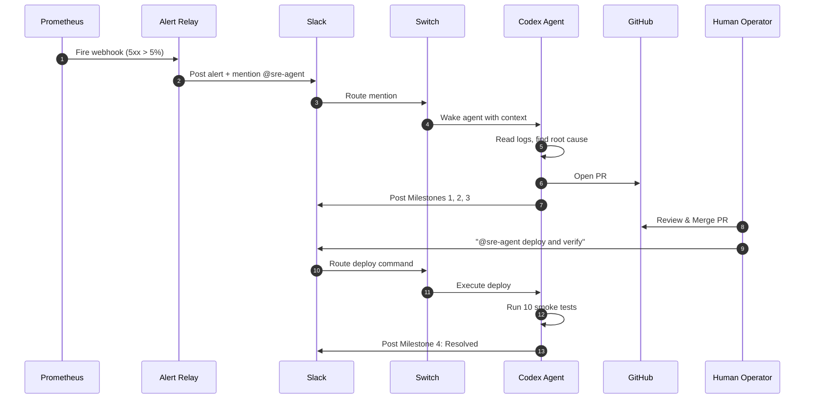

<div align="center">
  <h1>Sentinel: Closed-Loop Incident Response</h1>
  
  <a href="https://fastapi.tiangolo.com/" target="_blank">
    
  </a>
  &nbsp;&nbsp;
  <a href="https://prometheus.io/" target="_blank">
    
  </a>
  &nbsp;&nbsp;
  <a href="https://slack.com/" target="_blank">
    
  </a>
  &nbsp;&nbsp;
  <a href="https://www.atlassian.com/software/jira" target="_blank">
    
  </a>
  
  <br /><br />

  <a href="https://drive.google.com/file/d/1dQuJ42JxL9U_zgC3gwmWHH_mD6jtUY4y/view?usp=drive_link">
    
  </a>
</div>

<br />

**Sentinel** is an autonomous SRE agent that turns a standard alerting pipeline into a closed-loop incident response system. When a payments API fails in production, Prometheus notices. It routes the alert to Slack. An AI agent (Codex, connected via **Switch**) triages the failure, files a Jira ticket, opens a reviewed pull request, and—after a human merges and deploys—proves with metrics that the error rate is back to zero.

Sentinel is not a chatbot with a runbook. It has hands: it reads logs, queries Prometheus, reads the broken code, commits a fix, opens the PR, and closes the incident only when the numbers say so.

## Why Switch is the Central Nervous System

[Switch](https://github.com/sandbox-quantum/switch) is the bridge that makes this workflow possible. It sits between the Slack channel and the Codex agent, routing `@sre-agent` mentions directly to the agent's runtime. Without Switch, the agent would be a standalone script; with Switch, it's a full-fledged team member.

**How the channel is set up:** I connected my Slack workspace to Switch Console. The `#incidents` channel acts as the primary incident room. Codex is registered as a managed agent named `sre-agent`. When the Alert Relay posts a webhook to Slack mentioning `@sre-agent`, Switch detects the mention and wakes the Codex agent.

**The Human-in-the-Loop Advantage:** We intentionally designed Sentinel to be bounded. The agent can diagnose, write code, open a PR, and create a Jira ticket—but it **cannot merge or deploy without explicit human instruction**. This is a critical safety boundary for enterprise environments, ensuring that AI never pushes unverified code to production.

## Agent Safety & Guardrails

Giving an AI agent write access to production code is dangerous without strict boundaries. Sentinel is built with enterprise-grade guardrails:
- **Hard Limits:** The agent is restricted to a maximum of 15 tool calls and 10 minutes of wall-clock time per incident.
- **Path Scoping:** The agent is physically restricted to modifying only `payments-api/app/` and `payments-api/tests/`. It cannot touch infrastructure or configuration files.
- **No Force Pushes:** The agent commits via the GitHub Git Data API, never via `git push`. It opens a PR, but it cannot merge.
- **Operator Allowlist:** Only authorized Slack users (configured via `SLACK_ALLOWED_USERS`) can trigger write actions like deployment.

## What the demo shows

1. **The Trigger:** A chaos defect is enabled on the Payments API, causing a 100% 5xx error rate. Prometheus detects the spike and fires an alert to Alertmanager.
2. **The Alert:** The alert is relayed to the Slack `#incidents` channel, tagging `@sre-agent`. Switch routes this to Codex.
3. **The Triage:** Codex acknowledges the alert, reads the logs, and identifies the root cause: the API is blindly trusting the upstream response shape, causing a `KeyError`.
4. **The Fix:** Codex writes the fix (validating the upstream contract), opens PR #3 on GitHub, and creates Jira ticket KAN-8.
5. **The Human Gate:** The human operator reviews the PR. GitHub Actions (CI) has already run the tests and when they pass and when human reviews then they merges the PR.
6. **The Deploy:** The human types to `@sre-agent` to deploy and verify in Slack. Switch routes the command to Codex, which runs the deploy script and fires 10 smoke test payments.
7. **The Resolution:** All 10 payments return 200 OK. Codex posts (Resolved) in Slack, and the Prometheus error rate flatlines back to 0%.

## Tech Stack
- **Payments API:** FastAPI, SQLite, Chaos Endpoint
- **Observability:** Prometheus, Alertmanager
- **Agent:** Codex (via [Switch](https://github.com/sandbox-quantum/switch))
- **Integrations:** Slack (Incoming Webhooks + Switch Bridge), Jira (REST API), GitHub (Git Data API)
- **CI/CD:** GitHub Actions (runs tests on PR)

## Architecture

```mermaid
graph LR
    Browser["Browser / Customer"] -->|"POST /payments"| API["Payments API (FastAPI + SQLite)"]
    API -->|"scrape /metrics"| Prom["Prometheus"]
    Prom -->|"evaluate rules"| AM["Alertmanager"]
    AM -->|"webhook"| Relay["Alert Relay"]
    Relay -->|"post alert"| Slack["Slack #incidents"]
    Slack -->|"@sre-agent mention"| Switch["Switch Console"]
    Switch -->|"route to"| Codex["Codex Agent"]
    
    Codex -.->|"read logs/metrics"| API
    Codex -.->|"create ticket"| Jira["Jira KAN-*"]
    Codex -.->|"open PR"| GitHub["GitHub PR"]
    
    Human["Human Operator"] -->|"review & merge"| GitHub
    Human -->|"deploy and verify"| Slack
    Slack -->|"route command"| Switch
    Switch -->|"execute deploy"| Codex
    
    style Switch fill:#f9a03f,stroke:#333,stroke-width:2px
    style Codex fill:#f9a03f,stroke:#333,stroke-width:2px
    style Human fill:#4a90e2,stroke:#333,stroke-width:2px,color:#fff
```



## The Closed-Loop Workflow


## Quick Start

```powershell
git clone https://github.com/Abdeali1310/sentinel-sre.git
cd sentinel-sre
Copy-Item .env.example .env      # fill in your tokens
docker compose up -d --build
```

| Surface | URL |
|---|---|
| Checkout page | http://localhost:8001/ |
| Prometheus | http://localhost:9091 |
| Alertmanager | http://localhost:9093 |
| Alert Relay | http://localhost:8085/healthz |

**Trigger the Incident:**

```powershell
curl.exe -X POST http://localhost:8001/admin/chaos `
  -H "X-Chaos-Token: $env:CHAOS_TOKEN" `
  -H "Content-Type: application/json" `
  -d '{\"requests\":50,\"ttl_seconds\":600}'
```

## Repository Layout

```text
sentinel-sre/
├── payments-api/        # Target application (FastAPI, SQLite, Dockerfile)
├── sre-agent/           # Agent workspace (MCP tools, policy, docs)
├── alert-relay/         # Alertmanager webhook → Slack translator
├── prometheus/          # Scrape config + alert rules
├── alertmanager/        # Routing, grouping, webhook receiver
├── scripts/             # Setup, deploy, reset
└── docker-compose.yml   # api + prometheus + alertmanager + relay
```

## Roadmap & Known Issues

I built Sentinel to be robust, but like any system, there are integration edges I'm actively smoothing out.

- **OpenCode Integration:** I initially attempted to use OpenCode as my primary agent runtime. Despite being fully authorized and installed on my local machine, Switch failed to detect the OpenCode session. I pivoted to Codex, which worked flawlessly, but I would love to see native OpenCode detection in Switch.
- **Mattermost Support:** I started with Mattermost as my chat surface, but ran into bridging issues with Switch. Pivoting to Slack solved this, and I now recommend Slack as the most stable integration path for Switch.
- **Switch Gateway Stability:** During setup, I occasionally encountered a `HTTP 500` error from the Switch Gateway when attempting to create rooms via the Console UI. While I worked around this by adopting existing channels, smoother room provisioning would be a great addition.
- **Automated CI/CD Gating:** Currently, the human operator manually merges the PR after CI passes. A future iteration could allow the agent to monitor the GitHub Actions CI status and automatically proceed with deployment once the green checkmark appears, further reducing human toil.


---

Built for the **Flip the Switch Hackathon** by WeMakeDevs x Switch. 

Sentinel demonstrates what happens when an AI agent is given real hands and real guardrails. It fixes the code, opens the pull request, and verifies the recovery—but it knows when to ask for human permission. 

*"Because the best AI teammate isn't the one that takes over, but the one that knows when to hand back control."*